<!-- ZEROALEK -->

# A L E K

*curious by nature. quiet by design.*

---

---

<picture>
  <source media="(prefers-color-scheme: dark)" srcset="https://raw.githubusercontent.com/zeroalek/zeroalek/output/pacman-contribution-graph-dark.svg">
  <source media="(prefers-color-scheme: light)" srcset="https://raw.githubusercontent.com/zeroalek/zeroalek/output/pacman-contribution-graph.svg">
  
</picture>
